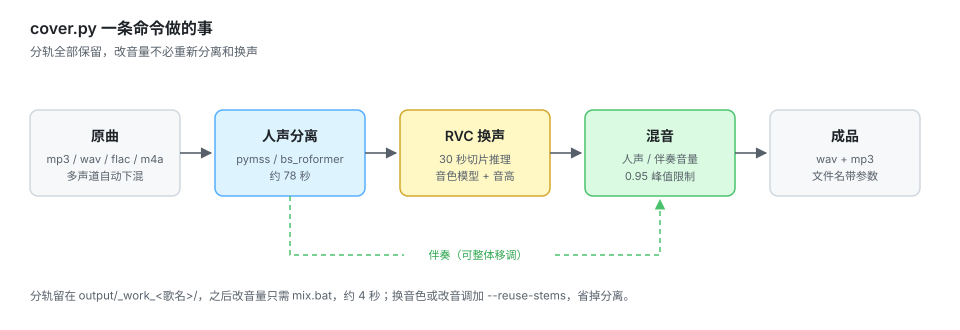

# RVC Cover Kit

给 [RVC（Retrieval-based-Voice-Conversion-WebUI）](https://github.com/RVC-Project/Retrieval-based-Voice-Conversion-WebUI) 加一层「一键翻唱」的拖拽脚本。

官方 WebUI 功能齐全，但要出一首成品得在几个标签页之间来回操作；调一次音量、换一次音调基本都要整首重跑。这套脚本把流程串成一条命令，并补了几个 WebUI 里没有的实用能力。

## 它做了什么

| 能力 | 说明 |
|---|---|
| 一条命令出成品 | 人声分离 → RVC 换声 → 移调 → 混音 → 导出 mp3/wav |
| 长歌切片推理 | 30 秒切片 + 0.3 秒交叉淡化。4 分钟的歌推理耗时从 491 秒降到 30 秒，同时避免整段推理崩坏 |
| 秒级重混音 | 分轨保留，改人声/伴奏比例只需 4 秒，不重新分离和换声 |
| 短片段扫参数 | 对同一段 20 秒音频并排跑多组参数，10 秒一组，不用整首试错 |
| 整体移调 | 人声与伴奏同步升降调，不会脱调 |
| 拖拽即用 | 把歌拖到 .bat 上，回答几个问题就行 |




实测耗时（RTX 5060 Laptop，4 分 09 秒的歌）：分离约 78 秒、换声约 30 秒、混音 1 秒，全流程约 110 秒。分轨留在 `output/_work_<歌名>/`，之后调音量只要 4 秒，换音色或改音调加 `--reuse-stems` 可以跳过分离。

## 环境要求

- Windows 10 / 11
- 已装好的 RVC 本体（`main` 分支，Python 3.12）
- 能跑的 `.venv` 虚拟环境，torch 版本与你的显卡匹配
- `ffmpeg` / `ffprobe` 在 PATH 里，建议用带 `rubberband` 滤镜的 full build
- 人声分离模型（pymss）

> NVIDIA 新卡（如 RTX 50 系，Blackwell sm_120）必须用 cu128 及以上 + torch ≥ 2.7，cu121 会报 `no kernel image is available`。
>
> ffmpeg 缺 `rubberband` 不会中断，`--transpose` 会自动回退到 `asetrate + atempo`，但音质略降、幅度大时更明显。

## 安装

### 1. 准备 RVC 本体

```bash
git clone https://github.com/RVC-Project/Retrieval-based-Voice-Conversion-WebUI.git
cd Retrieval-based-Voice-Conversion-WebUI

py -3.12 -m venv .venv
.venv\Scripts\python.exe -m pip install --upgrade pip
.venv\Scripts\python.exe -m pip install -r requirments_cu128_py312.txt
```

依赖文件按显卡选：`requirments_cu128_py312.txt`（40 系 / 50 系）、`requirments_cu118_py312.txt`（30 系及更早）、`requirments_cpu_py312.txt`（无独显，能用但很慢）。其余细节以官方文档为准。

### 2. 下载基础模型

这些是必须的基础模型，本项目不附带（体积大，且各有自己的许可）：

| 位置 | 内容 | 来源 |
|---|---|---|
| `assets/hubert_base/` | `config.json`、`preprocessor_config.json`、`pytorch_model.bin`（HF 目录格式，**不是** `hubert_base.pt`） | [RVC 官方 HuggingFace](https://huggingface.co/lj1995/VoiceConversionWebUI/tree/main) |
| `assets/rmvpe/` | `rmvpe.pt` | 同上 |
| `assets/pymss_weights/` | 分离模型，见下表 | [MSST](https://github.com/ZFTurbo/Music-Source-Separation-Training) 的 weights 目录 |

`assets/hubert_base/` 必须是个目录，脚本按 `config.json` 判断它是否存在，只放一个 `.pt` 会报 `Transformers HuBERT model not found`。

分离模型按需下载，**只有默认预设那一对是必需的**（ckpt 约 306 MB），其余预设按需补：

| 预设（`--sep-model`） | 需要的文件 | 用途 |
|---|---|---|
| `去伴奏`（默认，必装） | `model_bs_roformer_ep_368_sdr_12.9628.ckpt` + 同名 `.yaml` | 分出人声/伴奏，SDR 12.96 |
| `去伴奏（激进）` | `model_bs_roformer_ep_317_sdr_12.9755.ckpt` + 同名 `.yaml` | 咬得更狠，伴奏更干净但可能伤到人声 |
| `提主旋律` | `model_mel_band_roformer_karaoke_aufr33_viperx_sdr_10.1956.ckpt` + `config_mel_band_roformer_karaoke.yaml` | 卡拉 OK 场景 |
| 去混响 | `dereverb_mel_band_roformer_anvuew_sdr_19.1729.ckpt` + `dereverb_mel_band_roformer_anvuew.yaml` 等 | 湿声/现场录音 |

九件全套约 1.9 GB，只跑翻唱不需要。

也可以先跑一次 `start-webui.bat`，WebUI 会提示缺哪些文件。

### 3. 放入音色模型

```
assets/weights/你的音色.pth          # 必需
assets/indices/你的音色.index        # 可选，有的话检索效果更好
```

模型可以自己训练，也可以用别人的。注意模型来源的授权，详见文末免责声明。

### 4. 放入本项目的文件

把本仓库的 7 个文件全部复制到 RVC 根目录（和 `webui.py` 同一层）：

```
Retrieval-based-Voice-Conversion-WebUI/
├── webui.py
├── cover.py          ← 放这里
├── cover.bat         ← 放这里
├── mix.py  mix.bat
├── tune.py tune.bat
├── start-webui.bat
└── assets/ ...
```

脚本按自身所在目录定位模型和输出，**不要放进子文件夹**。`README.md`、`LICENSE`、`.gitignore` 只属于仓库，不用拷进 RVC。

## 四个 bat 的分工

| 文件 | 作用 | 操作 | 耗时 |
|---|---|---|---|
| `cover.bat` | 完整翻唱：分离 → 换声 → 移调 → 混音 | 拖歌曲上去，回答 5 个问题 | 4 分钟的歌约 2 分钟 |
| `tune.bat` | 只截一段试听，并排跑多组参数 | 拖歌曲上去，填起点/时长/扫哪个参数 | 首次 90 秒，之后每组 10 秒 |
| `mix.bat` | 只重混音，反复调人声与伴奏比例 | 拖歌曲或成品上去，填两个 dB 数 | 约 4 秒 |
| `start-webui.bat` | 启动官方 WebUI | 双击，浏览器开 `http://127.0.0.1:7897` | 约 20 秒 |

`start-webui.bat` 已把端口固定为 7897（RVC 自身默认是 7865，这里显式改了）。如果 7897 被占用，WebUI 会顺延到 7898、7899，以控制台打印的地址为准。

推荐顺序：**tune 挑参数 → cover 跑整首 → mix 微调音量**。mix 可以无限循环，每次几秒。

> 跑 cover / tune 前把 WebUI 关掉，能省显存、也更快。

## 交互项中文对照

脚本里的提示是英文（避免 Windows 控制台编码问题），对照如下：

**cover.bat**

| 提示 | 含义 | 默认 |
|---|---|---|
| `Model file` | 音色模型文件名 | `assets/weights` 下第一个 |
| `Feature retrieval ratio` | 特征检索比例 0~1 | 有同名 `.index` 时 0.5，否则 0 |
| `Transpose whole song` | 整体移调半音数 | 0 |
| `Vocal gain` | 翻唱人声音量 dB | −3 |
| `Instrumental gain` | 伴奏音量 dB | 0 |

**tune.bat**

| 提示 | 含义 | 默认 |
|---|---|---|
| `Clip start` | 试听起点（秒），建议填副歌 | 60 |
| `Clip length` | 试听长度（秒） | 20 |
| `Key to scan` | 要扫的参数名 | `index_rate` |
| `Values, comma separated` | 取值列表，逗号分隔 | 按参数自动给 |

可扫的参数：`index_rate` `protect` `rms_mix` `transpose` `pitch` `f0_method`

**mix.bat**

| 提示 | 含义 | 默认 |
|---|---|---|
| `Vocal gain` | 人声音量 dB | 沿用上次 |
| `Instrumental gain` | 伴奏音量 dB | 沿用上次 |

留空回车就是沿用上次的值。

## 关键参数说明

### `--transpose` 与 `--pitch` 的区别

| 参数 | 动谁 | 结果 |
|---|---|---|
| `--transpose -2` | 人声 **和** 伴奏一起降 2 半音 | 调性关系保持，**不脱调**（推荐） |
| `--pitch -2` | **只**动人声 | 人声比伴奏低 2 半音，**整首跑调**（高级用法） |

`--pitch` 只在一种情况下是对的：模型与歌曲音域差一个整八度，用 `±12` 平移，八度移调不破坏和声。

`--transpose` 不改速度、不改时长，音质在 ±3 半音内基本无感，±5 以上开始有金属味。

### `--index-rate`

特征检索强度，0~1，取 0.3~0.7 比较常用。两个默认值：

- 交互（bat）：有同名 `.index` 才给 0.5，否则 0
- 命令行：0.75

脚本会自己核对 index 是否存在，**没有配套 `.index` 时会强制降为 0 并打一行日志**，所以模型没有 index 时不用手动改。有 index 却仍然发虚、发闷，就把它往下调。

index 的匹配顺序是「精确同名 → 前缀 → 包含」，多个模型共存时不会互相串用；要指定具体文件用 `--index 路径.index`。

### `--protect`

清辅音/气声保护，0.2~0.5。调高会保留更多气声、齿音，声音更通透；过高会带出原唱残留。

### `--rms-mix`

音量包络混合，0~1。`0` 完全用模型自己的音量起伏，`1` 完全跟随原唱。默认 0.25 比较自然。

### `--f0-method`

音高提取算法。`rmvpe` 最准（默认）；`fcpe` 最快，适合批量试；`harvest` 对低音和说话更稳；`crepe` 最慢。

### 人声 / 伴奏音量（dB）

两个数字决定的是**相对比例**，不是总音量：

| 想要的效果 | 人声 | 伴奏 |
|---|---|---|
| 人声清楚靠前 | `+1` | `-4` |
| 接近原曲平衡 | `0` | `0` |
| 伴奏铺底、突出演唱 | `0` | `-6` |
| 人声融入音乐 | `-2` | `0` |

建议控制在 ±6 dB 内，再往上会撞限幅器，出现发闷、齿音发炸。混音末尾只做 0.95 峰值限制，**不做响度归一化**，所以你填多少就生效多少。

## 命令行用法

不想被问答打断，可以直接调脚本：

```bat
:: 整首翻唱，降 2 个半音
.venv\Scripts\python.exe cover.py "D:\Music\某首歌.flac" --model 你的音色.pth --transpose -2 --index-rate 0.5

:: 复用分轨，只换音色再跑一次
.venv\Scripts\python.exe cover.py "某首歌.flac" --model 另一个音色.pth --reuse-stems

:: 扫参数
.venv\Scripts\python.exe tune.py "某首歌.flac" --start 95 --dur 20 --vary protect=0.25,0.33,0.4

:: 秒级重混
.venv\Scripts\python.exe mix.py "某首歌.flac" --vocal-gain 1 --inst-gain -4

:: 直接对干声换声，跳过分离
.venv\Scripts\python.exe cover.py "干声.wav" --no-sep
```

完整参数：`.venv\Scripts\python.exe cover.py --help`

| 参数 | 默认 | 说明 |
|---|---|---|
| `input` | 必填 | 歌曲路径，mp3 / wav / flac / m4a |
| `--model` | `assets/weights` 下第一个 `.pth` | 音色模型文件名 |
| `--transpose` | 0 | 整体移调半音数，人声与伴奏同步（推荐） |
| `--pitch` | 0 | 只动人声的半音数（高级，会脱调） |
| `--speaker-id` | 0 | 多说话人模型用；单说话人模型无效 |
| `--index-rate` | 0.75（bat 给 0.5） | 特征检索比例，无 index 自动降 0 |
| `--index` | 自动 | 显式指定 `.index` 路径 |
| `--protect` | 0.33 | 清辅音/气声保护，0.2~0.5 |
| `--f0-method` | `rmvpe` | `rmvpe` / `fcpe` / `pm` / `harvest` / `crepe` |
| `--rms-mix` | 0.25 | 音量包络混合，0=随模型，1=随原唱 |
| `--resample` | 0 | 输出重采样率，0=保持模型原生（40k / 48k） |
| `--chunk-sec` | 30 | 切片长度（秒），显存紧张就调小 |
| `--overlap-sec` | 0.3 | 切片交叉淡化长度（秒） |
| `--vocal-gain` | −3 | 翻唱人声音量 dB |
| `--inst-gain` | 0 | 伴奏音量 dB |
| `--sep-model` | `去伴奏` | 分离预设，见上文表格 |
| `--no-sep` | 关 | 跳过分离，输入已是干声时用 |
| `--reuse-stems` | 关 | 复用上次分轨，跳过分离，省约 78 秒 |
| `--out-dir` | `RVC根目录/output` | 成品输出目录 |
| `--keep-stems` | 关 | 保留分轨（现已默认保留，只为兼容旧命令） |
| `--clean` | 关 | 跑完删除分轨。加了以后 `mix.bat` 就没法秒级重混 |
| `--loudnorm` | 关 | 额外做 −14 LUFS 归一化，会压缩音量比例，一般别加 |

`tune.py` 与 `mix.py` 的参数少得多，直接用 `--help` 看即可，几个共用的键（`--model` `--index-rate` `--out-dir`）语义与上表一致。

## 输出结构

```
output/
├── cover_<歌名>_pitch+0.wav / .mp3          # 成品
├── cover_<歌名>_pitch-2_tr-2.wav / .mp3     # 整体降 2 半音的成品
├── cover_<歌名>_mix_v-3_i-6.wav / .mp3      # 重混后的成品
└── _work_<歌名>/                            # 分轨，别删，mix 要用
    ├── source.wav                          # 解码后的原曲
    ├── vocals/                             # 分离出的人声
    ├── instrumental/                       # 分离出的伴奏
    ├── vocal_converted.wav                 # 换声后的人声
    ├── instrumental_transposed.wav         # 移调后的伴奏
    └── mix_meta.json                       # 上次用的参数
```

`tune` 的产物在 `tune/` 目录，分轨缓存在 `tune/_stem_<歌名>/`。

## 常见问题

**显存不足 / CUDA out of memory**
把切片调小：`cover.py 歌.mp3 --chunk-sec 15`。也确认 WebUI 已关闭。

**提示找不到模型**
`assets/weights` 里没有 `.pth`，或 bat 不在 RVC 根目录。脚本按自身位置找 `assets/`。

**人声发闷、破音、电音味**
先试 `--transpose -1` 或 `-2`（降调），多数是模型音域不够。再试降低 `--index-rate`、提高 `--protect`。

**人声和伴奏对不上、听着跑调**
用了 `--pitch` 而不是 `--transpose`。改用 `--transpose`。

**成品比原曲长**
当前版本已按模型采样率对齐切片索引，不会再有这个问题。如果遇到，检查是否用了旧版脚本。

**调了音量但听不出变化**
不要加 `--loudnorm`，它会把比例压回去。同理，成品总音量由播放器控制，不在混音里调。

**双击 bat 一闪就退**
在 cmd 里运行 `cover.bat "歌曲路径"`，能看到完整报错。

**成品跟原曲一起播对不上**
用了 `--transpose` 就会这样，成品整体换了调，属正常现象，单曲播放即可。

**只想换音色，不想重新分离**
加 `--reuse-stems`，跳过约 78 秒的分离，音调、切片都沿用上次的分轨。

**报 `Transformers HuBERT model not found`**
`assets/hubert_base/` 里缺 `config.json`，见上文「下载基础模型」。

**中文文件名能用吗**
可以，但避免路径里出现 `&` `^` `%` 等 cmd 特殊字符。

**跑得慢**
关掉 WebUI；同一个音色反复试就用 `--reuse-stems`，省掉约 78 秒的分离。

## 已知限制

- 只做离线批处理，不支持实时变声（RVC 自带 `realtime_gui.py` 可以做）
- 输入多声道（5.1 等）会自动下混成立体声
- 分离质量取决于 pymss 模型，伴奏残留人声时换更强的分离模型
- 长歌切片在段落交界处可能有极轻微的音色不一致

## 致谢

- [Retrieval-based-Voice-Conversion-WebUI](https://github.com/RVC-Project/Retrieval-based-Voice-Conversion-WebUI)（MIT）—— 换声内核
- [Music-Source-Separation-Training](https://github.com/ZFTurbo/Music-Source-Separation-Training) —— 人声分离
- [ffmpeg](https://ffmpeg.org/) + rubberband —— 移调与混音
- [faiss](https://github.com/facebookresearch/faiss) —— 特征检索

## 免责声明

- 音色模型（`.pth` / `.index`）多为他人训练或分发，**使用前请确认授权**，本仓库不附带任何模型。
- 翻唱作品涉及原曲的词曲著作权与录音制作者权，请仅用于个人学习研究，不要商用或公开传播。
- 请勿用于伪造他人声音、诈骗等用途。

## License

[MIT](LICENSE)
